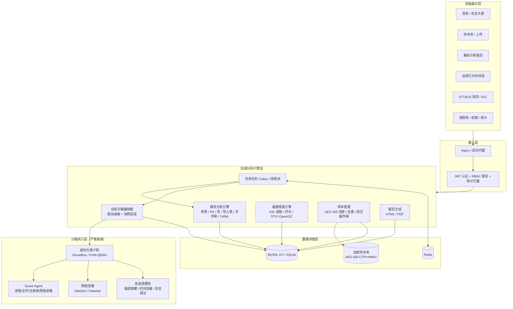
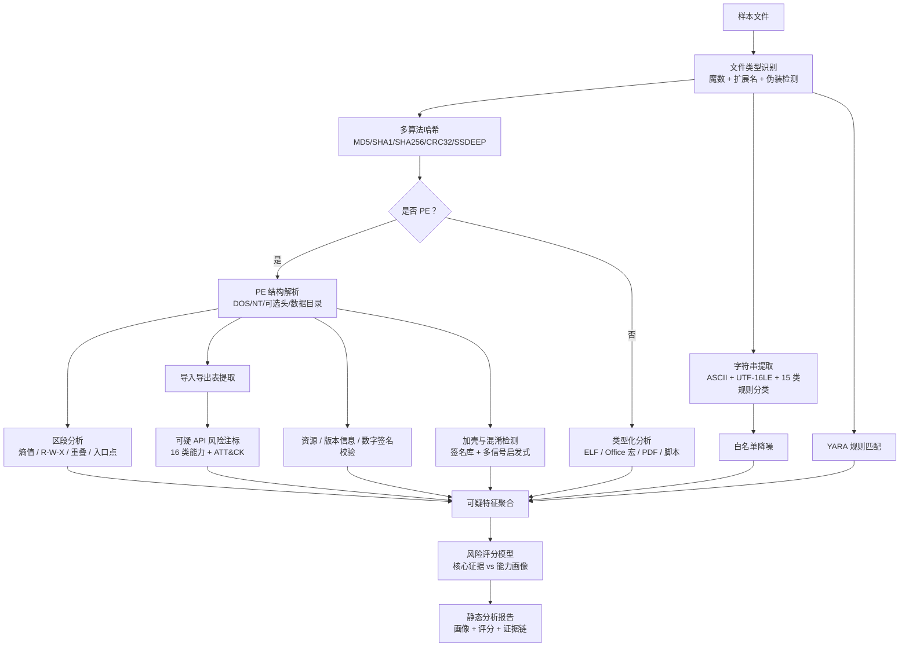
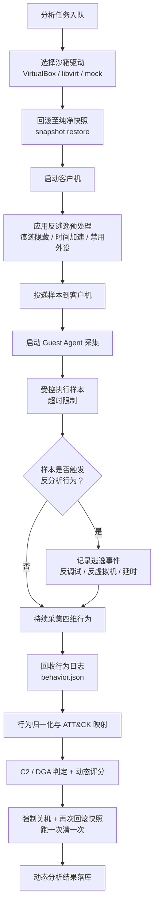
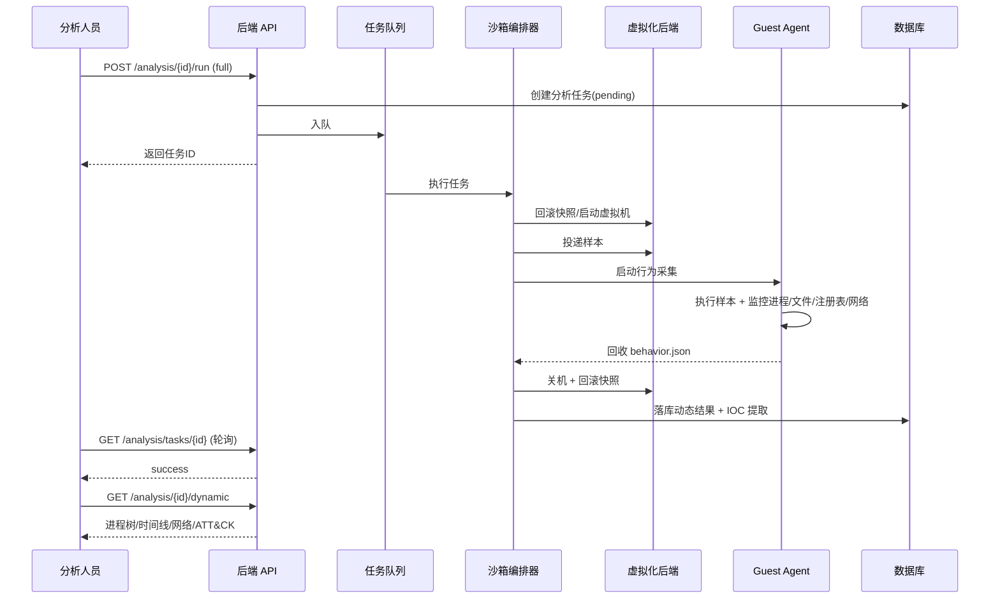
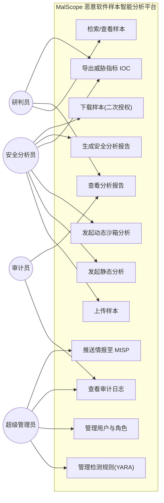
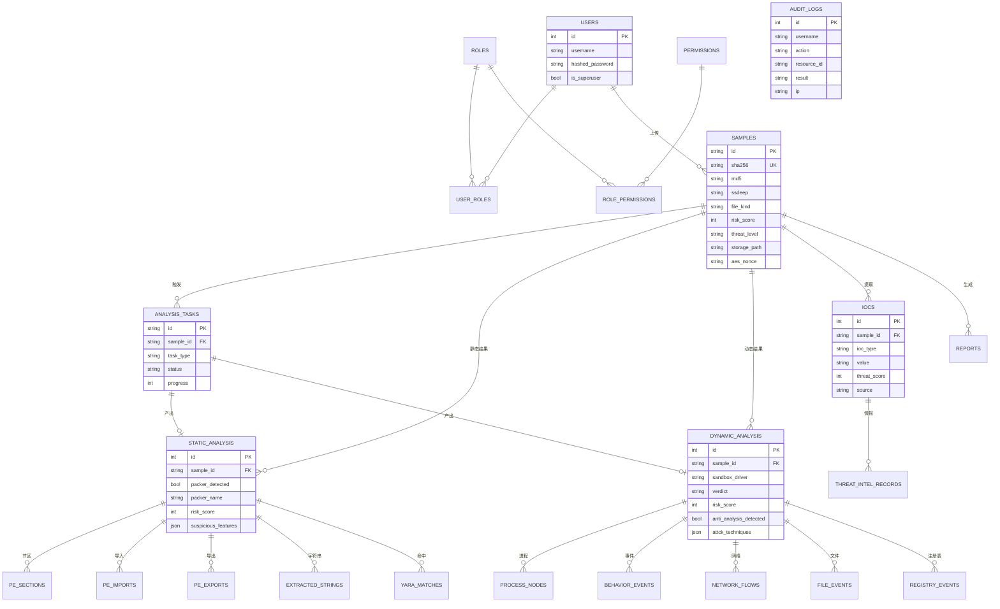
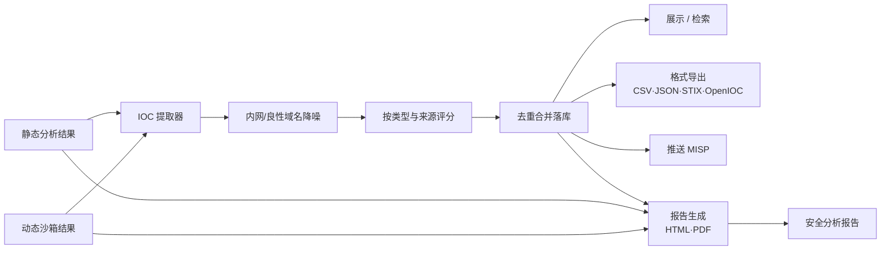
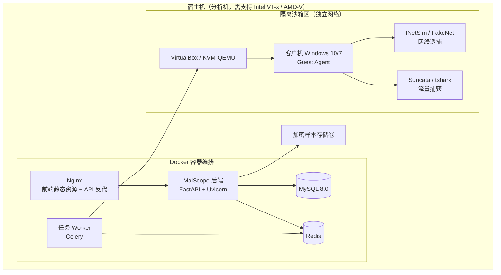
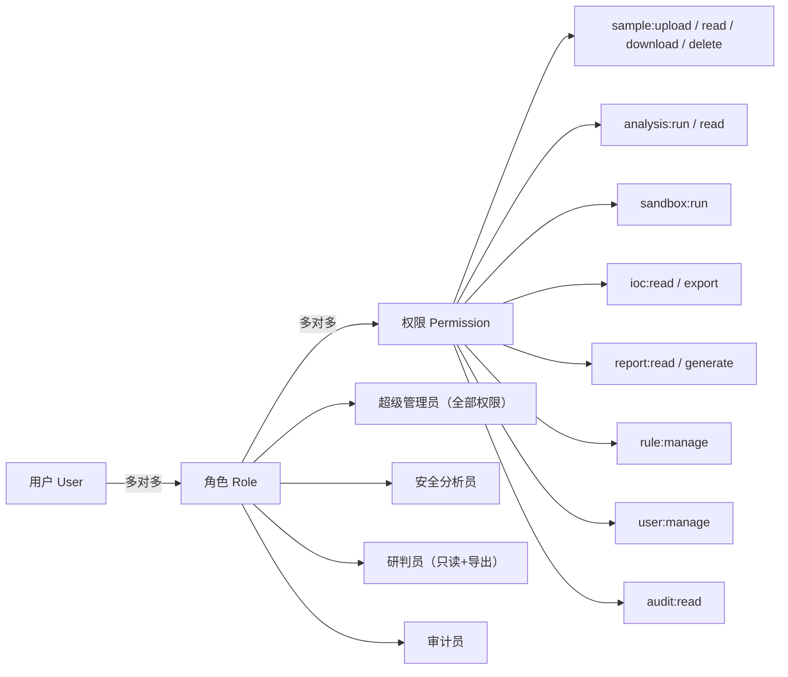

# MalScope 系统设计图集

> 所有图均使用 Mermaid 语法描述，可在支持 Mermaid 的编辑器（VS Code / Typora / GitHub）中直接渲染，
> 也可通过 <https://mermaid.live> 导出为 PNG/SVG。
> 各图的独立源文件见同目录下 `*.mmd`。

---

## 图 1 系统总体架构图（B/S 四层）

---

## 图 2 静态分析流程图

---

## 图 3 动态沙箱执行与回滚流程图

---

## 图 4 动态分析时序图

---

## 图 5 系统用例图

---

## 图 6 数据库 ER 图

---

## 图 7 IOC 提取与报告生成流程

---

## 图 8 部署架构图

---

## 图 9 权限模型（RBAC）

